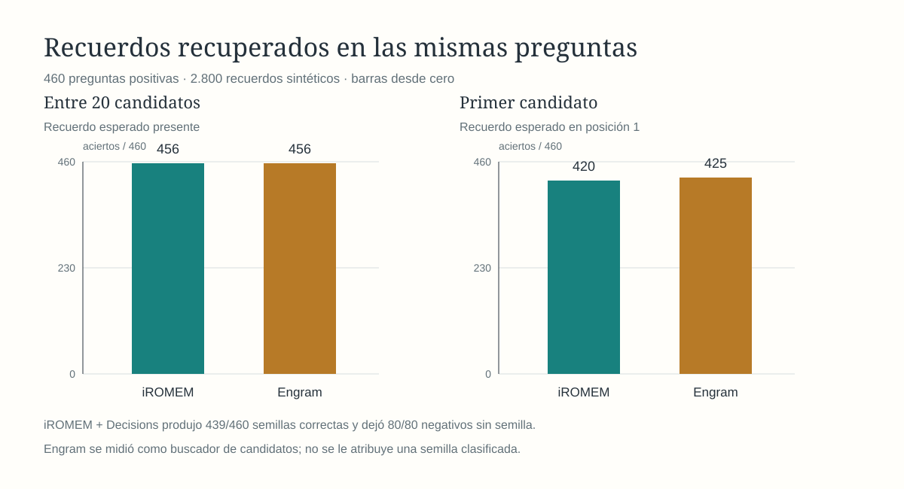
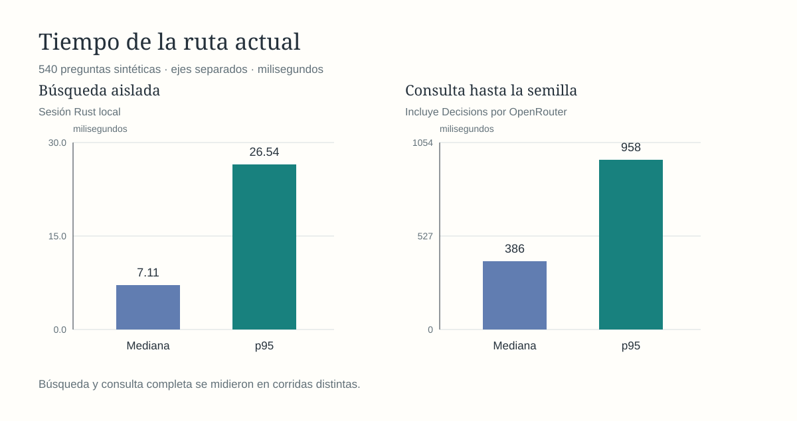

# iROMEM

iROMEM recupera recuerdos para preparar una memoria semilla antes de que un agente responda. La ruta actual usa búsqueda rápida FTS5 por palabras clave con expansión de prefijos y **Decisions** como clasificador, todo coordinado en Rust.

## Rendimiento actual

Medido en esta Mac con **2.800 recuerdos sintéticos** y **540 preguntas**: 460 requerían un recuerdo y 80 no requerían ninguno. Cada consulta presentó hasta 20 candidatos al clasificador. Los sujetos de esta muestra no se usaron para elegir el ajuste, aunque las preguntas comparten plantillas con otros bancos sintéticos.

| Medida | Resultado |
| --- | ---: |
| Recuerdo correcto entre los candidatos | **456/460 (99,1 %)** |
| Semilla correcta en preguntas positivas | **439/460 (95,4 %)** |
| Preguntas negativas sin semilla | **80/80 (100 %)** |
| Búsqueda aislada, mediana / p95 | **7,11 / 26,54 ms** |
| Consulta completa hasta la semilla, mediana / p95 | **386 / 958 ms** |
| Tokens de entrada informados por Decisions, mediana | **561** |

La búsqueda aislada y la consulta completa se midieron en corridas distintas; la segunda incluye la llamada a OpenRouter. **p95** indica que el 95 % de las consultas terminó en ese tiempo o menos. **Aún no se ha medido esta versión con entrega automática de la semilla a Codex.** Las cifras describen este banco sintético y no establecen la tasa de aciertos en conversaciones reales. El [método y los resultados por caso](docs/evaluation/keyword-prefix-v1.md) permiten comprobar la medición.

## Proyecto

El MVP se ejecuta localmente mediante la [CLI Rust](docs/evaluation/contract-v1.md). Decisions es el proveedor predeterminado; Jev puede elegirse por consulta. La integración automática con Codex sigue pendiente. Consulta el [roadmap](ROADMAP.md), la [arquitectura vigente](docs/architecture/overview.md) y el [diseño propuesto v0.1](docs/design/specification-v0.1.md).
