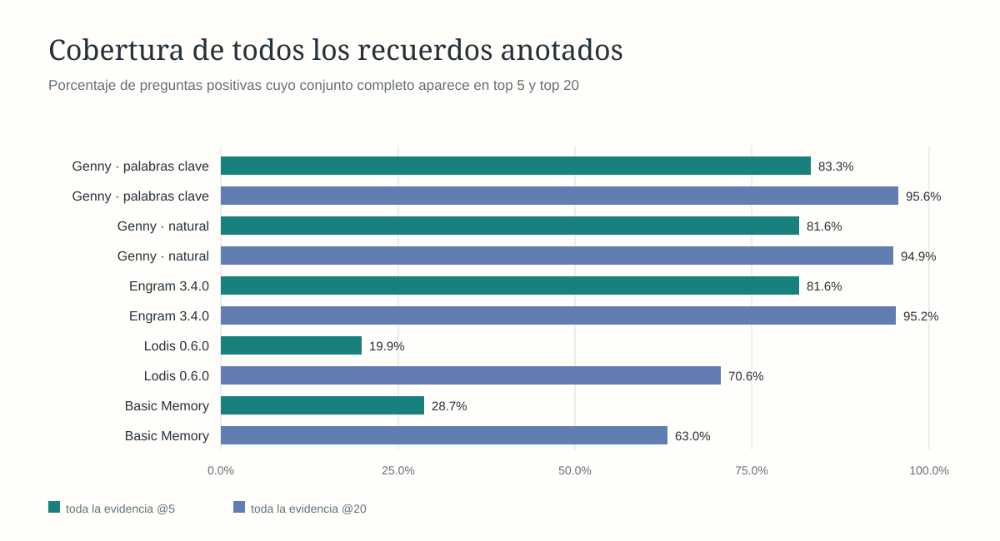
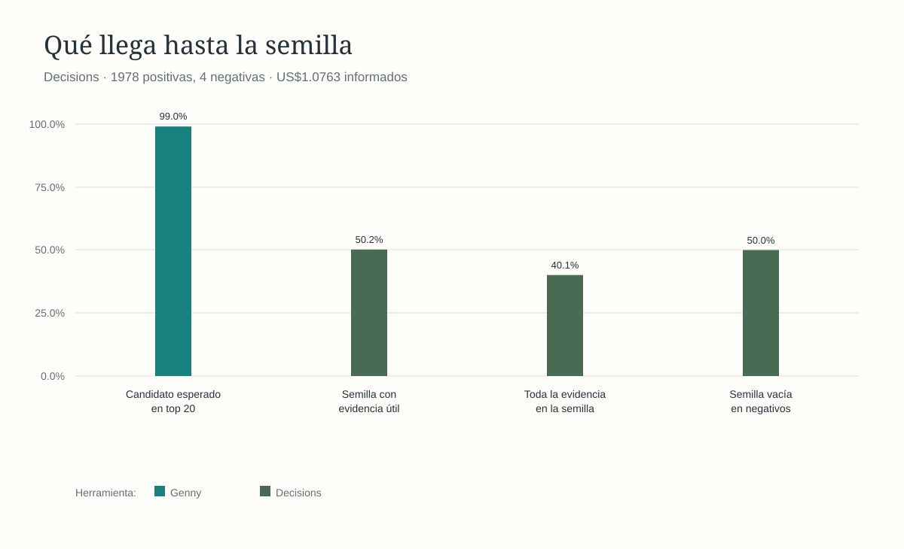

# Genny

Genny prepara recuerdos relevantes para que un agente de IA responda con contexto breve, sin tener que recorrer todo el historial en cada consulta. Corre localmente mediante CLI y sesiones JSONL.

## Índice

- [Rendimiento](#rendimiento)
- [Comparación con otros motores](#comparación-con-otros-motores)
- [Contexto y respuesta del agente](#contexto-y-respuesta-del-agente)
- [Cómo funciona](#cómo-funciona)
- [Contrato de producto v1 y comandos nuevos](docs/architecture/product-contract-v1.md)
- [Funcionamiento técnico y diseño de la memoria](docs/architecture/memory-design.md)
- [Roadmap resumido](ROADMAP-SUMMARY.md)
- [Roadmap detallado e historial](ROADMAP.md)

## Rendimiento

La corrida vigente usa [LoCoMo](docs/evaluation/locomo-results-2026-10-24.md): **272 recuerdos**, **1.982 preguntas evaluables** (1.978 positivas y 4 sin evidencia) y cuatro referencias de evidencia sin resolver excluidas. Las figuras comparan una corrida local por motor; p95 describe esa corrida y no una distribución entre repeticiones.

| Recuperación local | Palabras clave | Consulta natural |
| --- | ---: | ---: |
| Recuerdo esperado entre 20 | **99,04 %** | 98,84 % |
| Recuerdo esperado entre 5 | **92,92 %** | 90,95 % |
| Recuerdo esperado primero | **70,17 %** | 68,86 % |
| Conjunto completo de evidencia en top 20 | **95,60 %** | 94,89 % |
| Latencia p50 / p95 | **3,66 / 4,98 ms** | 3,88 / 5,79 ms |

## Comparación con otros motores

Se cargaron las mismas 272 memorias y se consultaron las mismas 1.982 preguntas. Las implementaciones y rutas no son idénticas: Engram usa MCP local con palabras clave; Lodis 0.6.0 usa híbrido con embeddings FastEmbed locales; Basic Memory usa FTS local y filtro de ámbito; Genny se midió con palabras clave y consulta natural.

| Motor | Recall@20 | Recall@5 | Top 1 | Evidencia completa@20 | p50 / p95 |
| --- | ---: | ---: | ---: | ---: | ---: |
| **Genny · palabras clave** | **99,04 %** | **92,92 %** | **70,17 %** | **95,60 %** | **3,66 / 4,98 ms** |
| Genny · natural | 98,84 % | 90,95 % | 68,86 % | 94,89 % | 3,88 / 5,79 ms |
| Engram 3.4.0 | 98,99 % | 91,56 % | 69,16 % | 95,25 % | **2,60 / 3,68 ms** |
| Lodis 0.6.0 | 77,15 % | 27,40 % | 6,57 % | 70,58 % | 39,12 / 118,91 ms |
| Basic Memory | 70,83 % | 36,45 % | 22,24 % | 63,04 % | 21,32 / 72,92 ms |

Las cuatro preguntas sin evidencia no bastan para comparar abstención: Basic Memory devolvió una lista vacía en 1/4; los otros motores, en 0/4. La cobertura completa cuenta si aparecen todos los IDs de evidencia anotados; Recall@20 cuenta si aparece al menos uno. Los resultados y las revisiones de código de terceros están en el [informe LoCoMo](docs/evaluation/locomo-results-2026-10-24.md).

## Selección de semilla y respuesta del agente

Decisions evaluó las 1.982 consultas. Recuperó un recuerdo anotado en **1.959/1.978** positivas; la semilla final incluyó evidencia útil en **993/1.978** y toda la evidencia anotada en **793/1.978**. De las cuatro preguntas sin evidencia, la semilla quedó vacía en **2/4**. El coste informado fue **US$1,0763**; el tiempo total de servicio tuvo p50 **420,55 ms** y p95 **903,96 ms**. Seleccionar evidencia no mide por sí solo si la respuesta final es correcta.

La validación de respuestas con Codex quedó pendiente: se congelaron 50 casos para GPT‑6 Luna, pero el Codex CLI de esta cuenta rechazó el modelo antes de generar una respuesta. No se sustituyó el modelo. La [evaluación anterior del 16 de octubre](docs/evaluation/broader-comparison-2026-10-16.md) sigue disponible como referencia histórica separada; sus seis turnos por ruta, gráficos de preparación, suma calculada y tokens no se presentan como resultados de LoCoMo ni como medidas vigentes.

## Cómo funciona

1. **Busca** recuerdos relacionados con la consulta dentro del ámbito indicado: usuario, agente, proyecto o conversación.
2. **Selecciona** los candidatos que sirven para responder, reutilizando una revisión compatible o consultando al clasificador.
3. **Prepara** una semilla breve con el contenido seleccionado y sus referencias, para que el agente la use como contexto.

El núcleo está escrito en Rust y los recuerdos se almacenan en SQLite. La interfaz actual es CLI/JSONL. La búsqueda predeterminada es por palabras clave; la búsqueda semántica sigue siendo experimental. La integración automática con agentes todavía está pendiente.

La CLI incluye `mem-write` para crear una memoria y `mem-write-batch` para escribir lotes de hasta 2.500 mediante la misma operación idempotente. Esta primera ruta es local y no ofrece todavía autenticación multiusuario, ACL ni resolución de duplicados. [Contrato de escritura](docs/architecture/memory-design.md#21-contrato-de-escritura).

Para contratos, almacenamiento, índices y ciclo de vida de los recuerdos, consulta el [funcionamiento técnico de la memoria](docs/architecture/memory-design.md). Para la distribución del código, consulta la [arquitectura vigente](docs/architecture/overview.md) y el [mapa de módulos](docs/architecture/modules.md).
