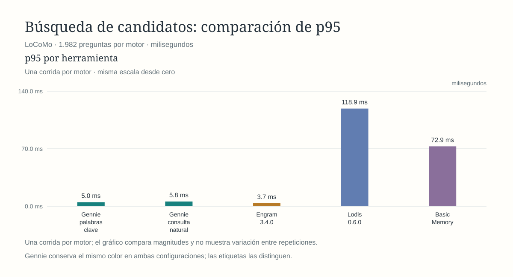
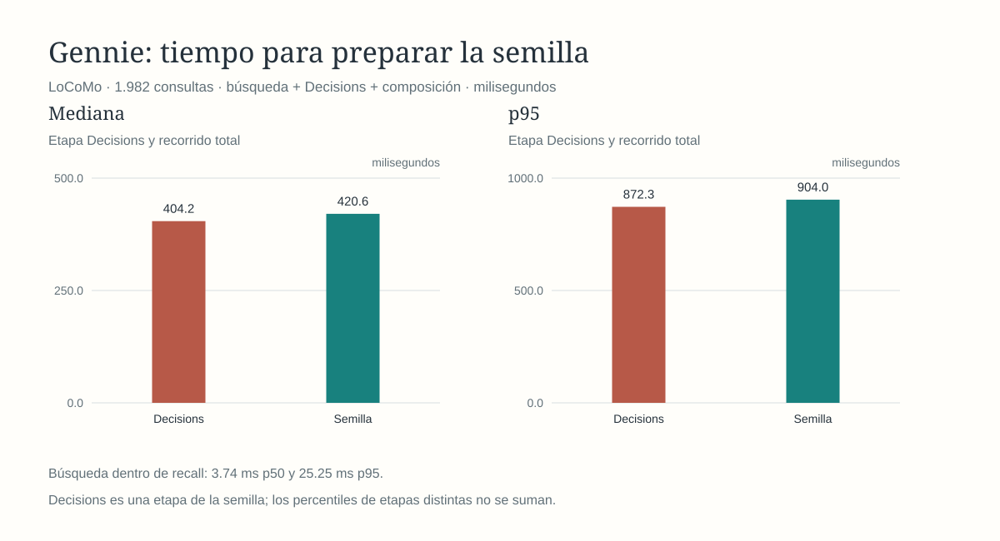

# Gennie

Gennie prepara recuerdos relevantes para que un agente de IA responda con contexto breve, sin tener que recorrer todo el historial en cada consulta. Corre localmente mediante CLI y sesiones JSONL.

## Índice

- [Rendimiento](#rendimiento)
- [Comparación con otros motores](#comparación-con-otros-motores)
- [Contexto y respuesta del agente](#contexto-y-respuesta-del-agente)
- [Cómo funciona](#cómo-funciona)
- [Embeddings locales v1: perfil, uso y pruebas](docs/architecture/local-embeddings.md)
- [Recuperación, entidades y aislamiento local](docs/architecture/retrieval-isolation.md)
- [Pruebas por etapa](docs/evaluation/retrieval-isolation/README.md)
- [Contrato de producto v1 y comandos nuevos](docs/architecture/product-contract-v1.md)
- [Escritura, propuestas, resolución y auditoría local](docs/architecture/write-reconciliation.md)
- [Verificación literal de fuentes locales](docs/evaluation/recall-source-verification/README.md)
- [Presupuestos de tokens de recall-v1: pruebas y coste local](docs/evaluation/recall-token-budgets/README.md)
- [Funcionamiento técnico y diseño de la memoria](docs/architecture/memory-design.md)
- [Roadmap resumido](ROADMAP-SUMMARY.md)
- [Roadmap detallado e historial](ROADMAP.md)

## Rendimiento

Las mediciones históricas siguientes no incorporan el nuevo contador de tokens de `recall-v1`. Su [prueba local de admisión](docs/evaluation/recall-token-budgets/04-cli.md) mide por separado primera carga y reutilización, sin inferencia remota.

La última corrida medida usa [LoCoMo](docs/evaluation/locomo-results-2026-10-24.md): **272 recuerdos**, **1.982 preguntas evaluables** (1.978 positivas y 4 sin evidencia) y cuatro referencias de evidencia sin resolver excluidas. Las gráficas conservan los mismos indicadores y la presentación de la comparación anterior. Cada herramienta mantiene su color; las dos configuraciones de Gennie comparten el suyo.

| Indicador | Gennie + Decisions |
| --- | ---: |
| Recuerdo anotado entre los 20 candidatos | **1.959/1.978 · 99,04 %** |
| Semilla con algún recuerdo anotado | **993/1.978 · 50,20 %** |
| Semilla vacía en preguntas sin evidencia | **2/4 · 50,00 %** |
| Tiempo hasta la semilla: mediana / p95 | **420,55 / 903,96 ms** |
| Coste informado por Decisions para 1.982 consultas | **US$1,076261** |

Estos tiempos corresponden al binario de esa campaña, anterior a la ampliación de filtros y conteos de cobertura. No se ha vuelto a medir el rendimiento del binario modificado.

La selección se compara con la evidencia anotada; no mide por sí sola la exactitud de la respuesta final. El banco y las limitaciones están descritos en el [informe LoCoMo](docs/evaluation/locomo-results-2026-10-24.md).

## Comparación con otros motores

Se cargaron las mismas 272 memorias y se consultaron las mismas 1.982 preguntas. Las implementaciones y rutas no son idénticas: Engram usa MCP local con palabras clave; Lodis 0.6.0 usa híbrido con embeddings FastEmbed locales; Basic Memory usa FTS local y filtro de ámbito; Gennie se midió con palabras clave y consulta natural.

| Búsqueda de candidatos | Gennie · palabras clave | Gennie · consulta natural | Engram 3.4.0 | Lodis 0.6.0 | Basic Memory |
| --- | ---: | ---: | ---: | ---: | ---: |
| Recuerdo anotado entre 20 | **99,04 %** | 98,84 % | 98,99 % | 77,15 % | 70,83 % |
| Recuerdo anotado en primer puesto | **70,17 %** | 68,86 % | 69,16 % | 6,57 % | 22,24 % |
| Latencia mediana | 3,66 ms | 3,88 ms | **2,60 ms** | 39,12 ms | 21,32 ms |
| Latencia p95 | 4,98 ms | 5,79 ms | **3,68 ms** | 118,91 ms | 72,92 ms |

Las cuatro preguntas sin evidencia no bastan para comparar abstención: Basic Memory devolvió una lista vacía en 1/4; los otros motores, en 0/4. Las corridas de LoCoMo fueron una por motor; el gráfico de p95 no representa variación entre repeticiones.

## Selección de semilla y respuesta del agente

Decisions evaluó las 1.982 consultas. Recuperó un recuerdo anotado en **1.959/1.978** positivas; la semilla final incluyó algún recuerdo anotado en **993/1.978**. De las cuatro preguntas sin evidencia, la semilla quedó vacía en **2/4**. El coste informado fue **US$1,076261**; el tiempo total de servicio tuvo p50 **420,55 ms** y p95 **903,96 ms**. Seleccionar evidencia no mide por sí solo si la respuesta final es correcta.

La validación de respuestas con Codex quedó pendiente: se congelaron 50 casos para GPT‑6 Luna, pero Codex CLI rechazó el modelo antes de generar respuestas. No se sustituyó el modelo. Por eso, las figuras de respuesta Codex y recorrido calculado conservan sus datos anteriores y se muestran solo como referencia histórica; no son mediciones LoCoMo.

## Cómo funciona

1. **Busca** recuerdos relacionados con la consulta dentro del ámbito indicado: usuario, agente, proyecto o conversación.
2. **Selecciona** los candidatos que sirven para responder, reutilizando una revisión compatible o consultando al clasificador.
3. **Prepara** una semilla breve con el contenido seleccionado y sus referencias, para que el agente la use como contexto.

El núcleo está escrito en Rust y los recuerdos se almacenan en SQLite. La interfaz actual es CLI/JSONL. La búsqueda predeterminada es por palabras clave; la búsqueda semántica sigue siendo experimental. La integración automática con agentes todavía está pendiente.

La CLI incluye `mem-write` para crear una memoria y `mem-write-batch` para escribir lotes de hasta 2.500 mediante la misma operación idempotente. Esta primera ruta es local y no ofrece todavía autenticación multiusuario, ACL ni resolución de duplicados. [Contrato de escritura](docs/architecture/memory-design.md#21-contrato-de-escritura).

Para contratos, almacenamiento, índices y ciclo de vida de los recuerdos, consulta el [funcionamiento técnico de la memoria](docs/architecture/memory-design.md). Las operaciones locales de retirada, restauración, revisión, borrado y cola E5 explícita están descritas en el [contrato de ciclo de vida](docs/architecture/memory-lifecycle.md). Para la distribución del código, consulta la [arquitectura vigente](docs/architecture/overview.md) y el [mapa de módulos](docs/architecture/modules.md).
