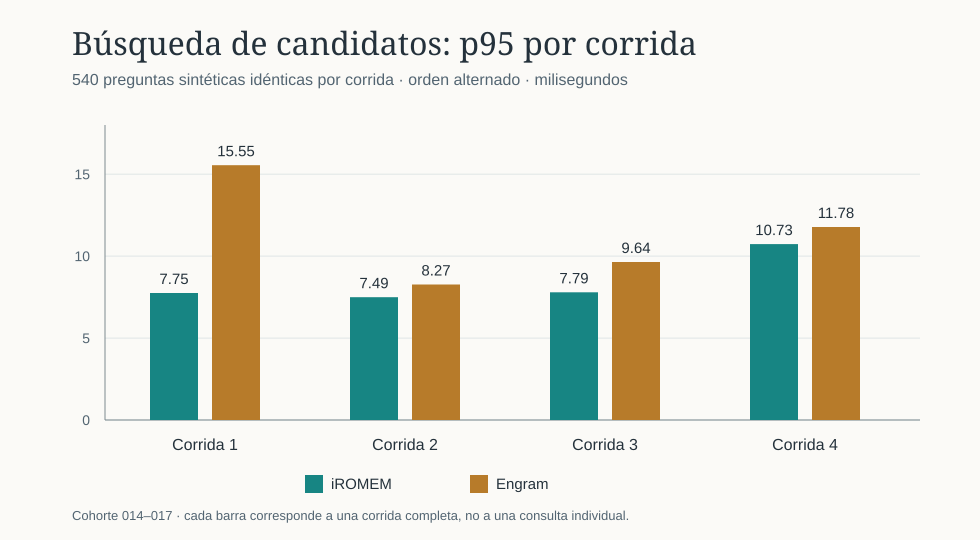

# Comparación completa nueva: iROMEM y Engram

Estado: campaña sintética ejecutada el 2026-10-16 en esta Mac. El [paquete reproducible](../../outputs/iromem/evaluation/full-comparison-2026-10-16/) conserva consultas, orden de cada corrida, resultados por caso, manifiestos, diarios, respuestas de Codex y [agregado](../../outputs/iromem/evaluation/full-comparison-2026-10-16/aggregate.json). Esta es la comparación vigente; las cifras de [la cohorte 010–013](keyword-prefix-v1.md) siguen como historia.

## Banco y método

Se fijó antes de medir la cohorte 014–017 del fixture `general-memory-v1`: **2.800 recuerdos**, **540 preguntas** en 16 ámbitos, **460 positivas** y **80 negativas**. No se modificaron búsqueda, prompts ni umbrales al ver los resultados. iROMEM usó FTS5 por palabras clave con prefijos, Decisions por defecto o Jev explícito; Engram 3.4.0 usó `mem_search`, `match_mode=any`, consulta de palabras clave normalizada y `response_format=compact`. Ambos limitaron a veinte candidatos y buscaron en el mismo contenido sintético, importado a almacenes independientes. La consulta y el ámbito eran equivalentes, pero los contratos no lo son: Engram recibió título y cuerpo, sin condiciones ni fuente declarada por revisión. Los **80 negativos también devolvieron veinte candidatos** en ambos motores; una lista de candidatos no constituye abstención.

Para medir la cola local se fijaron cuatro permutaciones de las mismas 540 preguntas con semillas `20261016`–`20261019`. Dentro de cada pareja se usó el mismo orden de preguntas; el orden de motores fue Engram→iROMEM, iROMEM→Engram, iROMEM→Engram y Engram→iROMEM. Cada proceso persistente recibió una consulta de calentamiento excluida. Los tiempos por pregunta incluyen ida y vuelta por stdio, ejecución, serialización y análisis de la respuesta; Engram incluye además el mapeo de IDs en el evaluador. No son tiempos puros de SQLite. Cada cifra p95 procede de una corrida completa; la mediana entre corridas resume cuatro p95, no un percentil calculado sobre consultas independientes.

Las campañas de `recall` con Decisions y Jev ejecutaron una vez cada una las mismas 540 preguntas y registraron coste y tiempos informados. Un primer intento de Decisions en la red restringida terminó en `transport_error` y está [separado](../../outputs/iromem/evaluation/full-comparison-2026-10-16/recall-decisions-restricted-network.jsonl); no entra en las cifras. La campaña válida usó un diario nuevo y no tuvo degradaciones. Para Codex se fijaron antes de las respuestas cinco positivos y un negativo de los cuatro tipos de ámbito, mediante [selection.json](../../outputs/iromem/evaluation/full-comparison-2026-10-16/selection.json). Cada camino se ejecutó dos veces; el orden fue semilla→Engram→control y control→semilla→Engram. Se usó Codex CLI `0.162.0-alpha.17.2`, modelo `gpt-6.1-sol`, procesos efímeros y sandbox de solo lectura. El runner entregó la semilla en el prompt; iROMEM aún no tiene hook automático.

## Recuperación de candidatos

| Aciertos entre 460 positivos | iROMEM | Engram |
| --- | ---: | ---: |
| Top 1 | 420 (91,30 %) | **427 (92,83 %)** |
| Top 5 | **450** | 445 |
| Top 10 | **454** | 452 |
| Top 20 | **457 (99,35 %)** | 456 (99,13 %) |

En top 20 ambos acertaron 453 casos, solo iROMEM acertó cuatro y solo Engram tres. En top 1, ambos acertaron 412, solo iROMEM ocho y solo Engram quince. La calidad de candidatos fue idéntica entre las cuatro repeticiones de cada motor; esas repeticiones miden variación temporal, no aportan cuatro bancos independientes de exactitud.

| Corrida y primer motor | iROMEM p50 / p95 | Engram p50 / p95 |
| --- | ---: | ---: |
| 1 · Engram | 7,06 / **7,75 ms** | 7,35 / 15,55 ms |
| 2 · iROMEM | 6,69 / **7,49 ms** | 6,78 / 8,27 ms |
| 3 · iROMEM | 6,79 / **7,79 ms** | 7,08 / 9,64 ms |
| 4 · Engram | 7,68 / **10,73 ms** | 9,15 / 11,78 ms |
| Mediana de las cuatro corridas | **6,93 / 7,77 ms** | 7,22 / 10,71 ms |

Como comprobación adicional, se tomó la mediana de las cuatro mediciones de **cada pregunta** y después el p95 de esas 540 medianas: **7,63 ms iROMEM y 9,41 ms Engram**. Este cálculo reduce la influencia de picos de una sola corrida, pero no sustituye el p95 observado en cada ejecución. El p95 de **26,54 ms** de iROMEM en 010–013 no reapareció; la corrida 4 muestra que los tiempos de ambos motores aún pueden variar. No se registró telemetría de CPU, memoria o E/S para atribuir los picos a una causa del sistema.

## Semilla y abstención de iROMEM

| Medición de 540 consultas | Decisions | Jev |
| --- | ---: | ---: |
| Semilla correcta en 460 positivos | **441 (95,87 %)** | 417 (90,65 %) |
| Negativos con semilla vacía | **80/80** | 77/80 |
| Consulta → semilla p50 / p95 | 369,62 / 567,22 ms | **366,96 / 443,53 ms** |
| Tokens de entrada informados, p50 | **560** | 962 |
| Coste total informado | US$0,02974200 | **US$0,02156549** |
| Respuestas degradadas / IDs prohibidos | 0 / 0 | 0 / 0 |

En los positivos, ambos clasificadores acertaron 411, solo Decisions 30 y solo Jev seis; ambos fallaron trece. Decisions también se abstuvo en las tres negativas que Jev falló. Los dos proveedores informaron cero tokens de salida de mediana; ese campo no permite reconstruir el consumo completo. La diferencia de latencia remota procede de una sola campaña por proveedor y no debe atribuirse únicamente al modelo.

El coste informado conjunto de las dos campañas de OpenRouter fue **US$0,05130749**. Es un valor reportado por el proveedor para estas llamadas sintéticas, no una factura auditada.

Engram no ejecutó un clasificador de semilla equivalente en esta suite. Su cobertura top 20 no debe compararse como si fuera la tasa de semilla correcta de Decisions o Jev.

## Respuesta con Codex

Los cinco hechos positivos y la negativa fueron respondidos correctamente por **ambos caminos con memoria en las dos rondas**: diez positivos y dos negativas por camino, al contrastar el texto guardado con los hechos del fixture. El control sin memoria no recibió los datos positivos. Engram hizo siete llamadas MCP en cada ronda de seis turnos, incluida una segunda llamada en el negativo.

| Camino | Mediana ronda 1 | Mediana ronda 2 | Tokens de entrada informados, p50 por ronda |
| --- | ---: | ---: | ---: |
| Codex con semilla ya entregada | **4,79 s** | **5,18 s** | 17.005,5 / 17.005,5 |
| Codex → Engram MCP | 9,97 s | 11,34 s | 52.859 / 52.885,5 |
| Codex sin memoria | 5,11 s | 5,06 s | 16.958 / 16.958 |

La preparación previa de la semilla por `recall` tuvo 0,37 s de mediana en esos seis casos. La **suma calculada por caso** de preparación y respuesta con semilla dio medianas de **5,20 y 5,80 s** en las rondas 1 y 2; combina ejecuciones separadas y **no mide** una integración automática de iROMEM con Codex. El prompt con semilla añadió 48 tokens de entrada de mediana frente al control emparejado. Los totales de Codex incluyen instrucciones y caché, y los prompts de ambos caminos con memoria son distintos porque uno recibe contexto y el otro debe buscarlo. Codex no informó coste monetario para estos turnos.

## Lectura del resultado y límites

La ruta vigente **iROMEM + Decisions** es el postulante mejor sustentado para preparar una semilla en este banco: cubrió un caso más en top 20, acertó 441/460 positivos y se abstuvo en 80/80 negativos. Engram ordenó siete positivos más en primer lugar. En las cuatro corridas locales iROMEM tuvo menor p95 de búsqueda, y en los dos pilotos Codex la semilla ya entregada produjo respuestas más rápidas que pedirle a Codex que buscase por MCP. Son observaciones de esta configuración, no una declaración de superioridad general ni una comparación de contratos equivalentes.

Los sujetos 014–017 eran nuevos, pero comparten plantillas y el mismo corpus sintético con las cohortes anteriores. Se conocía el ámbito; no se midieron resolución de ámbito, recuerdos reales, escritura/indexación, verificación externa de fuente, hook instalado, consumo completo de recursos ni coste monetario de Codex. Seis preguntas fáciles repetidas no estiman la tasa general de acierto de Codex. Los percentiles locales se midieron en una Mac y los tiempos remotos dependen también del servicio. La siguiente prueba de producto debe medir la entrega automática real y usar preguntas humanas con ámbitos y respuestas menos previsibles.
