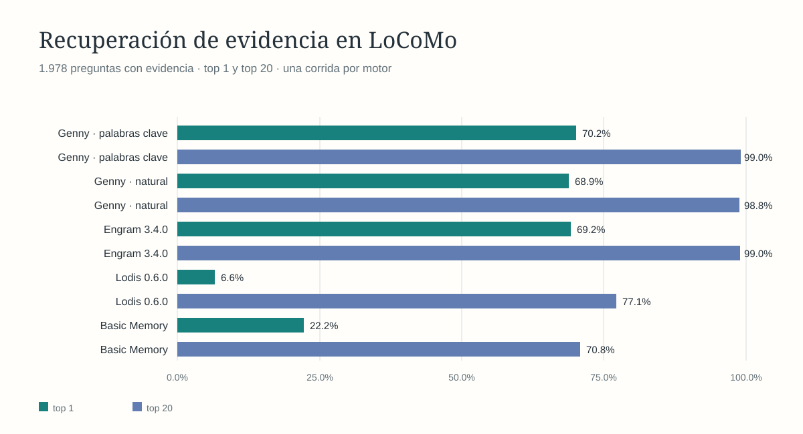
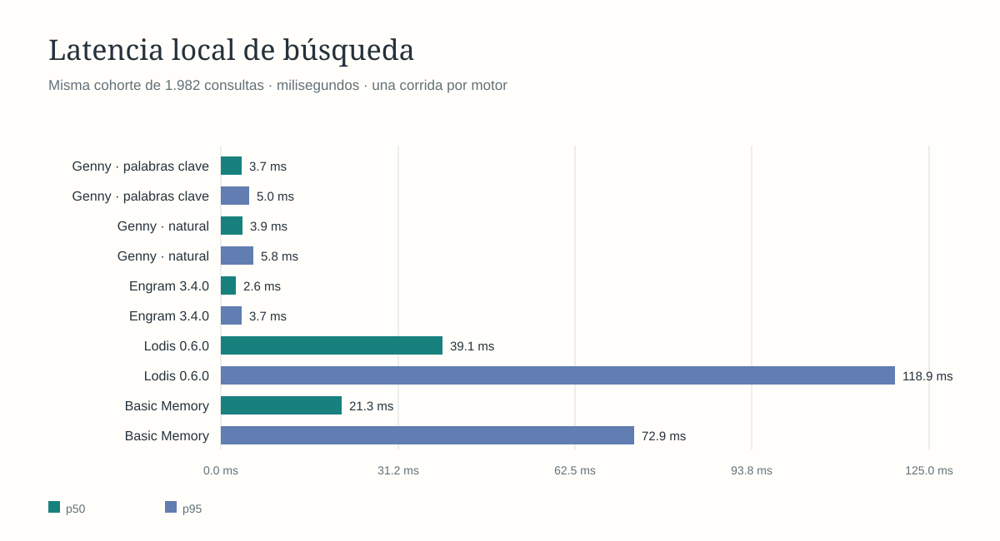

# Comparación de recuperación y selección sobre LoCoMo

Estado: búsqueda ejecutada el 24 de octubre de 2026; campaña de Decisions y cuatro búsquedas externas completadas. La respuesta final con Codex no se ejecutó porque Codex CLI rechazó GPT‑6 Luna antes de producir una salida. No se sustituyó el modelo.

## Banco y unidad de evaluación

El dataset está fijado al repositorio [LoCoMo](https://github.com/snap-research/LoCoMo), revisión `3eb6f2c585f5e1699204e3c3bdf7adc5c28cb376`. La preparación importa cada sesión de conversación como un recuerdo mediante `mem-write`; no transforma las 272 sesiones en preguntas ni genera recuerdos desde las respuestas. Hashes SHA‑256: fuente `79fa87e90f04081343b8c8debecb80a9a6842b76a7aa537dc9fdf651ea698ff4`; consultas `ed63a80b7e9e1073c1d172a36a87d7617d39d6df635feb11259f9ca5f16dc1aa`; corpus canónico de recuerdos `16a881dcf26b6edbe9a13b98dbafa660b31b0408a5a39206f7913fb7ec9c503b`. El manifiesto y el contrato de importación están en `.local/locomo/manifest.json`.

El banco contiene 1.986 preguntas: 1.978 positivas con evidencia completa, cuatro negativas sin evidencia y cuatro preguntas cuyas referencias no se pudieron resolver. Las cuatro referencias no resueltas se excluyen de búsqueda, campaña y denominadores. Las 1.982 preguntas restantes comparten consultas, ámbitos exactos y 272 recuerdos. La muestra de Codex quedó congelada en 50 IDs antes de revisar respuestas: incluye las cuatro negativas, y 12, 12, 10 y 12 positivas de las categorías 1–4. Se excluyó la categoría 5 porque LoCoMo la etiqueta como adversarial, no como respuesta gold estándar.

`Recall@k` cuenta una consulta positiva cuando aparece al menos un ID esperado en los k candidatos. `Top 1` mide ese mismo criterio para el primer candidato. La cobertura completa cuenta una consulta positiva solo cuando todos sus recuerdos anotados aparecen antes de k. Son métricas de correspondencia con evidencia anotada, no evaluación de verdad de una respuesta generada.

## Resultados de búsqueda

Cada fila es una corrida de 1.982 consultas. Las latencias se calcularon desde un único pase, sin repetición; p95 no representa variación entre corridas.

| Motor/configuración | Recall@20 | Recall@5 | Top 1 | Evidencia completa@20 | p50 | p95 | Negativos vacíos |
| --- | ---: | ---: | ---: | ---: | ---: | ---: | ---: |
| Gennie · FTS5 palabras clave | 1.959/1.978 · 99,04 % | 1.838/1.978 · 92,92 % | 1.388/1.978 · 70,17 % | 1.891/1.978 · 95,60 % | 3,66 ms | 4,98 ms | 0/4 |
| Gennie · consulta natural | 1.955/1.978 · 98,84 % | 1.799/1.978 · 90,95 % | 1.362/1.978 · 68,86 % | 1.877/1.978 · 94,89 % | 3,88 ms | 5,79 ms | 0/4 |
| Engram 3.4.0 · MCP keywords | 1.958/1.978 · 98,99 % | 1.811/1.978 · 91,56 % | 1.368/1.978 · 69,16 % | 1.884/1.978 · 95,25 % | 2,60 ms | 3,68 ms | 0/4 |
| Lodis 0.6.0 · MCP híbrido | 1.526/1.978 · 77,15 % | 542/1.978 · 27,40 % | 130/1.978 · 6,57 % | 1.396/1.978 · 70,58 % | 39,12 ms | 118,91 ms | 0/4 |
| Basic Memory · FTS local | 1.401/1.978 · 70,83 % | 721/1.978 · 36,45 % | 440/1.978 · 22,24 % | 1.247/1.978 · 63,04 % | 21,32 ms | 72,92 ms | 1/4 |

En los cuatro casos sin evidencia, Gennie, Engram y Lodis devolvieron candidatos en todos los casos; Basic Memory devolvió lista vacía en uno. Cuatro negativos son insuficientes para concluir una tasa general de abstención. Basic Memory indexó también embeddings locales, pero su adaptador cronometró FTS con palabras clave normalizadas y filtros exactos de ámbito. Lodis usó búsqueda híbrida, filtro de dominio y embeddings locales `all-MiniLM-L6-v2`. Engram usó MCP local y palabras clave normalizadas. Estas rutas son configuraciones comparadas sobre el mismo banco, no una comparación de implementaciones idénticas.





## Decisions y semilla de Gennie

La campaña completa ejecutó 1.982 solicitudes con proveedor `decisions`, política `baseline` y semántica `any_evidence_memory`. Se registraron 1.982 respuestas completas y ningún caso degradado. El diario y los recibos están en `.local/locomo/evaluation/current-v1/decisions-baseline.jsonl`; el informe agregado está en `decisions-report.json`.

| Etapa | Resultado |
| --- | ---: |
| El recuerdo esperado llegó al top 20 | 1.959/1.978 positivas · 99,04 % |
| La semilla seleccionó algún recuerdo anotado como evidencia | 993/1.978 positivas · 50,20 % |
| La semilla seleccionó toda la evidencia anotada | 793/1.978 positivas · 40,09 % |
| Semilla vacía en preguntas negativas | 2/4 · 50,00 % |
| Coste informado por el proveedor | US$1,0762609 |
| Latencia de selección p50 / p95 | 404,17 / 872,35 ms |
| Tiempo total del servicio p50 / p95 | 420,55 / 903,96 ms |

El `correct` agregado es 995: 993 positivas con evidencia útil más dos negativas con semilla vacía. Las negativas con candidatos fueron 4/4. Esta comparación separa búsqueda candidata de selección; el benchmark no juzga si la respuesta final del agente expresa correctamente los recuerdos.

La estimación anterior del coste asumía aproximadamente US$0,11 para esta corrida. El coste registrado fue US$1,0762609, casi diez veces mayor, debido al tamaño de las solicitudes y al volumen de tokens. No se hicieron más llamadas pagadas a proveedores después de conocer el coste final.

## Contrato estable de las gráficas

`tools/evaluation/render_locomo_comparison.py` genera, a partir de los cinco informes de recuperación y el informe de Decisions, exactamente cuatro SVG vigentes: `locomo-retrieval-accuracy.svg`, `locomo-search-latency.svg`, `locomo-search-p95-runs.svg` y `locomo-seed-preparation.svg`. Rechaza informes con una cohorte distinta de 1.982 casos (1.978 positivos, cuatro negativos), conserva orden fijo de motores, escalas desde cero, etiquetas de datos y diseño de paneles. No añade fechas de ejecución ni valores aleatorios; mismos informes y versión del generador producen bytes idénticos.

| Archivo | Dato de entrada | Salida estable |
| --- | --- | --- |
| `locomo-retrieval-accuracy.svg` | `recall_at_20` y `top_1_accuracy` de cada `overall`, convertidos a aciertos de 1.978 | Dos paneles verticales: recuerdo entre veinte candidatos y primer candidato. |
| `locomo-search-latency.svg` | `overall.latency_ms.p50` y `.p95` | Dos paneles verticales; mediana y p95 de la corrida completa por motor. |
| `locomo-search-p95-runs.svg` | `overall.latency_ms.p95` | Un panel por motor, eje propio desde cero y una barra para la única corrida disponible. No expresa dispersión. |
| `locomo-seed-preparation.svg` | `classifier_p50/p95_ms`, `service_total_p50/p95_ms` y `search_p50/p95_ms` del informe Decisions | Mediana y p95 del paso Decisions frente al tiempo total para preparar la semilla; muestra búsqueda en la nota inferior, sin sumar percentiles. |

El orden de motores es Gennie palabras clave, Gennie consulta natural, Engram 3.4.0, Lodis 0.6.0 y Basic Memory. Las gráficas de recorrido y Codex/tokens no se generan desde LoCoMo: conservan las SVG históricas congeladas, ya que no hubo respuestas Codex comparables.

La paleta del README queda fijada: Gennie teal (`#18817e`), Engram dorado (`#b77a27`), Lodis azul (`#617db1`), Basic Memory violeta (`#8a6f9b`) y Decisions ladrillo (`#b75948`). Los cuatro SVG regenerados usan esta paleta y los mismos tamaños, tipografía, fondo, ejes y ubicación de etiquetas.

Las figuras de recorrido calculado y de turno/tokens Codex permanecen como referencias históricas del 16 de octubre: no se generan con la cohorte LoCoMo porque Codex CLI rechazó el modelo solicitado antes de responder. Se actualizarán solo cuando exista una corrida comparable; no se infieren datos actuales a partir de esa referencia.

## Codex y revisión de versión

Se fijaron 50 casos para el modelo solicitado `gpt-6-luna`, selección SHA‑256 `7dfe1c6f425f4da7d68d4e036f86b63bac9f85076be62a9af378c66c2021e292`. Codex CLI `0.154.0`, autenticado con una cuenta ChatGPT, rechazó el primer turno con `model_not_found`: “The 'gpt-6-luna' model is not supported when using Codex with a ChatGPT account.” El runner detuvo la prueba; no generó respuestas ni las sustituyó por otro modelo. El diagnóstico se conserva en `.local/locomo/evaluation/current-v1/codex-model-availability.json`. La documentación oficial publica `gpt-6-luna` como ID del modelo para la API, pero no habilita ese ID en esta sesión CLI; no había credencial de API de OpenAI configurada para ejecutar por esa vía ([GPT‑6 Luna](https://developers.openai.com/api/docs/models/gpt-6-luna)).

Las figuras de turno/tokens de Codex y recorrido calculado del [README](../../README.md) proceden del piloto de seis preguntas sintéticas del 16 de octubre. Permanecen como historia y no son métricas LoCoMo ni medidas vigentes. La figura de preparación de semilla sí usa la campaña actual de Decisions.

## Dependencias y reproducibilidad

El corpus externo conserva las revisiones usadas para respetar la comparación anterior: [Engram v3.4.0](https://github.com/Gentleman-Programming/engram/releases/tag/v3.4.0), binario macOS arm64 SHA‑256 `d0aa59c9a83d17ae3fc7f5dd31fdab6a26fd8c00fc5e692195753cd0719294f7`; [Basic Memory](https://github.com/basicmachines-co/basic-memory), commit `a72751c5d626380dedeed30f55f7a80ba3dc710d`; y [Lodis](https://github.com/Sunrise-Labs-Dot-AI/lodis), commit `bf3d89197321a10f6bb845528cfa567d6fd95021` (`0.6.0`). Basic Memory se aisló en un `BASIC_MEMORY_CONFIG_DIR` nuevo. Lodis recibió parches solo en el checkout temporal para redirigir la base y la caché local bajo `LODIS_BENCHMARK_DIR`; su almacén produjo embeddings para 272/272 recuerdos. Ninguna modificación de configuración tocó almacenes personales de estos motores.

La preparación exporta `memory-corpus.json` desde solicitudes `mem-write` y recibos confirmados, incluyendo el ID Gennie canónico, texto original, síntesis y ámbito. Hash del corpus de esta corrida: `16a881dcf26b6edbe9a13b98dbafa660b31b0408a5a39206f7913fb7ec9c503b`. Los JSONL, informes detallados, almacenes y binarios reproducibles están en `.local/locomo/`, ignorado por Git. Comandos principales:

```sh
python3 tools/datasets/prepare_locomo.py
target/debug/gennie-memory-eval retrieval .local/locomo/evaluation/current-v1/genny-keywords.jsonl .local/locomo/search-cases.jsonl .local/locomo/evaluation/current-v1/genny-keywords-summary.json
target/debug/gennie-memory-eval retrieval .local/locomo/evaluation/current-v1/genny-natural.jsonl .local/locomo/search-cases.jsonl .local/locomo/evaluation/current-v1/genny-natural-summary.json
target/debug/gennie-memory-eval campaign .local/locomo/search-cases.jsonl target/debug/gennie-memory .local/locomo/write-validation.db .local/locomo/evaluation/current-v1/decisions-baseline.jsonl decisions locomo_full_v1 1982 baseline
target/debug/gennie-memory-eval campaign-report .local/locomo/evaluation/current-v1/decisions-baseline.jsonl .local/locomo/evaluation/current-v1/decisions-report.json
target/debug/gennie-memory-eval engram-benchmark .local/locomo/search-cases.jsonl .local/locomo/memory-corpus.json .local/locomo/tooling/engram-3.4.0/engram .local/locomo/evaluation/current-v1/engram-data .local/locomo/evaluation/current-v1/engram.jsonl locomo_full_v1
target/debug/gennie-memory-eval retrieval .local/locomo/evaluation/current-v1/engram.jsonl .local/locomo/search-cases.jsonl .local/locomo/evaluation/current-v1/engram-summary.json
target/debug/gennie-memory-eval retrieval .local/locomo/evaluation/current-v1/lodis.jsonl .local/locomo/search-cases.jsonl .local/locomo/evaluation/current-v1/lodis-summary.json
target/debug/gennie-memory-eval retrieval .local/locomo/evaluation/current-v1/basic-memory-retry.jsonl .local/locomo/search-cases.jsonl .local/locomo/evaluation/current-v1/basic-memory-summary.json
target/debug/gennie-memory-eval codex-prompt .local/locomo/evaluation/current-v1/decisions-baseline.jsonl .local/locomo/search-cases.jsonl .local/locomo/evaluation/current-v1/codex-selection.json /Users/fer/.local/bin/codex .local/locomo/evaluation/current-v1/codex-genny-seed seed gpt-6-luna
python3 tools/evaluation/render_locomo_comparison.py --keywords .local/locomo/evaluation/current-v1/genny-keywords-summary.json --natural .local/locomo/evaluation/current-v1/genny-natural-summary.json --engram .local/locomo/evaluation/current-v1/engram-summary.json --lodis .local/locomo/evaluation/current-v1/lodis-summary.json --basic .local/locomo/evaluation/current-v1/basic-memory-summary.json --decisions .local/locomo/evaluation/current-v1/decisions-report.json --output docs/evaluation/assets/locomo-2026-10-24
```

Verificación de código: `cargo fmt --all --check`, `cargo test --offline -p gennie-memory-eval` (711 pasaron) y `cargo build --offline -p gennie-memory-eval` pasaron. Los cuatro SVG se renderizaron y revisaron visualmente. No se ejecutaron pruebas de respuestas Codex ni se recrearon las figuras históricas de respuesta porque el modelo solicitado fue rechazado por la cuenta CLI.
