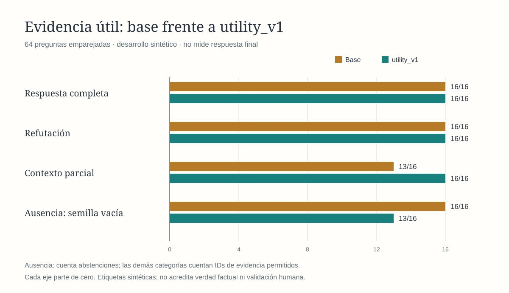
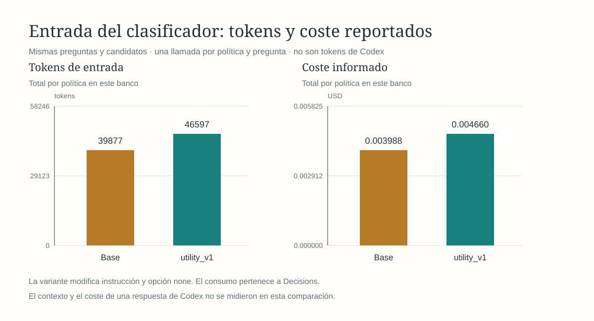

# Cohorte nueva v2: utilidad recupera contexto, pero mezcla referentes

**`utility_v1` no supera el contraste nuevo y no se promueve.** Con las instrucciones congeladas recuperó tres contextos parciales que la base omitía, pero introdujo tres selecciones de datos correspondientes a otra edición, equipo o entorno. El criterio previo prohibía esas selecciones, sin compensarlas con ganancias. Se conserva `baseline` y el límite de 20 candidatos.

## Datos y revisión anterior a las llamadas

El 2026-10-18 se creó una cohorte sintética nueva de ocho conversaciones (`042`–`049`), 224 recuerdos (28 por ámbito) y 64 preguntas, 16 por relación. Cada ámbito incluye datos de otros referentes y doce registros auxiliares repetitivos. Las condiciones se expresan en la frase, con `conditions` estructurado nulo. No es una prueba humana, de compresión, de resolución de entidad ni de respuesta final generada.

El usuario autorizó un subagente crítico. Este recibió únicamente frases fuente y preguntas sin etiquetas; no vio categorías, citas del autor, cuota por categoría ni resultados de modelos. Coincidió inicialmente con las 64 categorías y citas, pero detectó cuatro ambigüedades: proyector genérico frente a coste costero, pregunta en pasado frente a premio futuro, domingo sin referencia al mantenimiento y emisión de un altavoz desconectado. Antes de buscar o clasificar se aclararon esos referentes/estados; no cambiaron las categorías. Una segunda revisión confirmó los 64 casos sin ambigüedades sustanciales pendientes y sin afectar a los demás.

Se conservan [revisión final](../../tests/fixtures/conversation-evidence-v2/blind-review.json), [conciliación y hashes](../../tests/fixtures/conversation-evidence-v2/adjudication.json), [etiquetas originales](../../outputs/iromem/evaluation/utility-v1-cohort-v2-2026-10-18/author-labels-initial.jsonl), [fuente inicial](../../outputs/iromem/evaluation/utility-v1-cohort-v2-2026-10-18/source-initial.json), [preguntas iniciales](../../outputs/iromem/evaluation/utility-v1-cohort-v2-2026-10-18/blind-questions-initial.json) y [revisión inicial](../../outputs/iromem/evaluation/utility-v1-cohort-v2-2026-10-18/blind-review-initial.json). Es revisión separada entre agentes de la misma familia, con posibles sesgos compartidos; no se presenta como validación humana o independencia entre familias de modelo. Los campos `human_review` e `independent_review` permanecen falsos, y `review_status` registra la revisión ciega entre agentes.

## Protocolo y cobertura

Se aplicó el [protocolo previo](utility-v1-cohort-v2-protocol-2026-10-18.md), conservando exactamente las instrucciones y la descripción de `none` del experimento v1. El [preflight](../../outputs/iromem/evaluation/utility-v1-cohort-v2-2026-10-18/runs/preflight.json) liga hashes de datos, revisión, protocolo, código y binarios. No hubo ajustes después de observar resultados ni repeticiones para rescatar casos.

La búsqueda local cubrió 16/16 respuestas, 16/16 refutaciones y 16/16 contextos parciales. El primer candidato fue el permitido en 16/16, 14/16 y 10/16, respectivamente. Ninguna lista estuvo vacía; 47/64 alcanzaron el límite de 20 y las demás tuvieron entre ocho y veinte candidatos. No se eliminaron casos por su rango. Por tanto, las omisiones de evidencia útil de esta campaña se producen en selección, con el recuerdo disponible.

Se ejecutaron 128 operaciones, dos por pregunta, adyacentes y con orden alternado sin mirar etiquetas: Decisions, `keywords`, límite 20, una SQLite temporal y un proceso `session`. Ambas políticas recibieron listas de candidatos idénticas. El runner solo transmite búsqueda y política; no envía las anotaciones al proveedor. Las 128 operaciones terminaron, sin degradación ni reintentos inciertos.

## Resultado emparejado

| Relación o error | Base | `utility_v1` |
| --- | ---: | ---: |
| Respuesta completa: ID permitido | 16/16 | 16/16 |
| Refutación: ID permitido | 16/16 | 16/16 |
| Contexto parcial: ID permitido | 13/16 | 16/16 |
| Ausencia: semilla vacía | 16/16 | 13/16 |
| Selecciones de ID no permitido | 0 | 3 |
| Degradaciones | 0 | 0 |

La variante no perdió evidencias útiles seleccionadas por la base, pero sus tres nuevas selecciones no permitidas activaron el bloqueo. Las tres ganancias de contexto parcial fueron `cev2q_043_05` (catorce sierras, longitud desconocida), `cev2q_045_06` (mantenimiento en febrero, duración desconocida) y `cev2q_047_05` (treinta y una muestras, masas desconocidas). No se calcula un porcentaje agregado que compense errores con ganancias.

| Caso bloqueante | Pregunta pide | Recuerdo seleccionado por la variante |
| --- | --- | --- |
| `cev2q_042_07` | Escala de la edición de **navegación** | Escala uno a cinco mil de la edición de **sala**. |
| `cev2q_043_08` | Casillero del equipo **verde** | Identificador CR-17 del equipo **rojo**. |
| `cev2q_045_08` | Cuenta de transmisión de **producción** | Cuenta ensayo-verde del entorno de **pruebas**. |

La base se abstuvo en esos tres casos. Ambos anotadores ya habían determinado que el corpus no aporta el dato del referente solicitado; la etiqueta no se cambió tras ejecutar. Las semillas conservan literalmente los calificadores del recuerdo. Por eso el hallazgo es **selección no pertinente por referente**, no evidencia de que iROMEM haya inventado o reescrito hechos ni prueba de que Codex haya respondido con ellos. La respuesta posterior no se ejecutó.

La base obtuvo más refutaciones en v2 que en v1, pero son preguntas, fuentes y distractores diferentes. No se atribuye ese cambio entre cohortes a una mejora del producto ni se presenta v2 como uniformemente más difícil en todas las categorías. La comparación interpretada aquí es base frente a variante dentro de la misma cohorte.

## Gráficas de esta cohorte

Las [gráficas del desarrollo v1](utility-v1-development-charts-2026-10-18.md) quedan separadas y conservan sus denominadores y procedencia. Ambas parejas de SVG se generaron en Rust, se renderizaron con librsvg y se inspeccionaron visualmente. Las gráficas principales del README permanecen vinculadas a su ruta y cohortes identificadas.

## Coste y tiempos

| Medición | Base | `utility_v1` |
| --- | ---: | ---: |
| Llamadas / recibos | 64/64 | 64/64 |
| Tokens de entrada reportados | 39.877 | 46.597 |
| Coste reportado, USD | 0,0039877 | 0,0046597 |
| Runner p50 / p95 / p99, ms | 360,43 / 574,34 / 920,96 | 361,42 / 559,92 / 677,22 |

Modelo servido en las 128 llamadas: `openai/gpt-6-luna-decisions-20261006`. La variante añade 6.720 tokens y USD 0,000672 en sus 64 consultas (+16,85 %, 105 tokens por consulta). El porcentaje es menor que en v1 porque hay más contexto de candidatos; la diferencia absoluta sigue siendo la misma. El total reportado de esta campaña es USD 0,0086474, sin recibos ausentes. No son tokens de Codex, de semilla ni una auditoría de factura.

La mediana de la diferencia por par, variante menos base, fue +0,71 ms; p95 +179,81 ms y p99 +318,46 ms. Las colas marginales menores no establecen aceleración poblacional ni latencia de integración. Solo hay una observación por pregunta y política, con red.

## Verificación y decisión

La auditoría Rust verificó hashes, eventos completos, 2.360 apariciones de candidatos y 96 recuerdos de semillas (45 base, 51 variante), incluidos texto, condiciones, fuente declarada, ámbito, revisión, estado y vigencia. No verifica fuentes externas ni afirmaciones de una respuesta final. La [comprobación mecánica separada](../../outputs/iromem/evaluation/utility-v1-cohort-v2-2026-10-18/runs/verification.json) recontó los diarios y cotejó etiquetas con la revisión ciega, candidatos, transiciones, costes y hashes previos. Las 24 pruebas del evaluador pasaron; también formato e integridad. No hubo cambios de código de producto en esta entrega.

Se descarta la promoción de `utility_v1` bajo el criterio previo y se preserva para reproducir el experimento. No se retoca ahora el prompt, no se reinterpretan las tres selecciones como éxitos y no se reejecuta esta cohorte para aprobarla. El estado vigente de la decisión 0018 y el roadmap reflejan el fallo de contraste; `baseline`, límite 20 y cierre limitado de M5 permanecen.

La hipótesis siguiente es exigir compatibilidad del sujeto, edición, equipo y entorno antes de aceptar una parte útil. Estos seis cambios de selección pueden servir para diagnosticar ese requisito, pero ya son desarrollo conocido: una futura variante deberá fijarse antes de otra cohorte, sin usar v2 como validación intacta. Siguen pendientes fuentes y preguntas naturales, independencia humana, respuestas finales y medición de integración automática.

Archivos: [banco congelado](../../tests/fixtures/conversation-evidence-v2/manifest.json), [búsqueda](../../outputs/iromem/evaluation/utility-v1-cohort-v2-2026-10-18/retrieval-report.json), [preparación](../../outputs/iromem/evaluation/utility-v1-cohort-v2-2026-10-18/runs/preparation.json), [diario](../../outputs/iromem/evaluation/utility-v1-cohort-v2-2026-10-18/runs/journal.jsonl), [auditoría](../../outputs/iromem/evaluation/utility-v1-cohort-v2-2026-10-18/runs/audit.json), [reporte pareado](../../outputs/iromem/evaluation/utility-v1-cohort-v2-2026-10-18/runs/report.json) y [manifiesto de resultados](../../outputs/iromem/evaluation/utility-v1-cohort-v2-2026-10-18/manifest.json).
