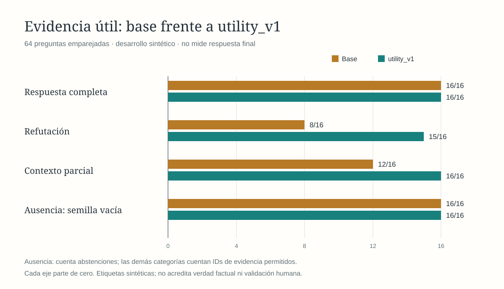
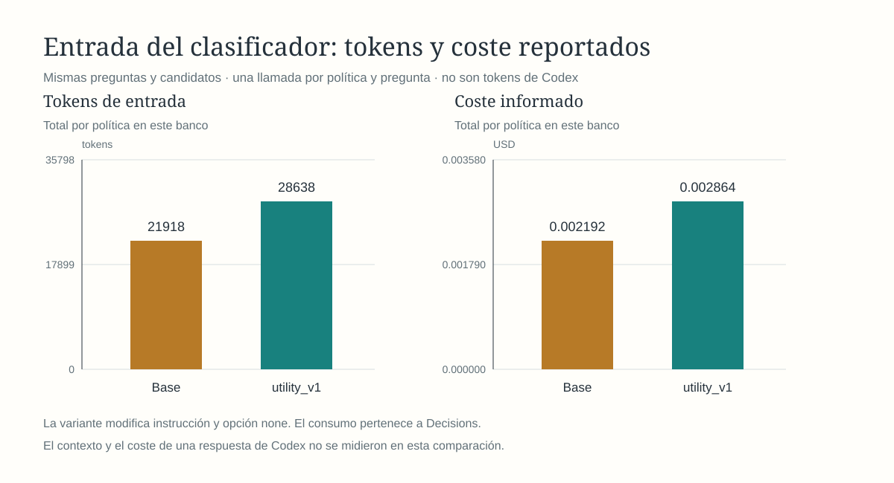

# Gráficas de desarrollo: utilidad v1

Estas figuras describen el [contraste emparejado de desarrollo](utility-v1-paired-results-2026-10-18.md): 64 preguntas sintéticas conocidas, misma búsqueda y una llamada por pregunta y política. No sustituyen las figuras de las cohortes identificadas en el README ni miden Codex.

Las tres primeras categorías cuentan IDs de evidencia permitidos; la cuarta cuenta semillas vacías cuando no hay evidencia. Son denominadores de 16 casos, no una estimación humana general. Las etiquetas se fijaron antes de la línea base original, pero esa base ya había sido observada al crear la variante.

Los tokens son de entrada a Decisions. Base: 21.918 y USD 0,0021918; variante: 28.638 y USD 0,0028638. El aumento fue 30,66 %, sin llamadas adicionales por consulta. La figura redondea el coste a seis decimales; el [reporte fuente](../../outputs/iromem/evaluation/utility-v1-paired-2026-10-18/report.json) conserva el valor reportado completo y recibos. No se midieron tokens de semilla ni de respuesta de Codex.

Las SVG se generan en Rust con `render-utility-comparison <report.json> <directorio-nuevo>`. Conservan fondo crema, títulos Georgia, paleta oro/verde, ejes desde cero, cifras directas y notas de alcance. Se renderizaron a PNG con librsvg y se inspeccionaron visualmente. Los datos y manifiestos originales permanecen congelados; este documento es un acompañamiento nuevo.
