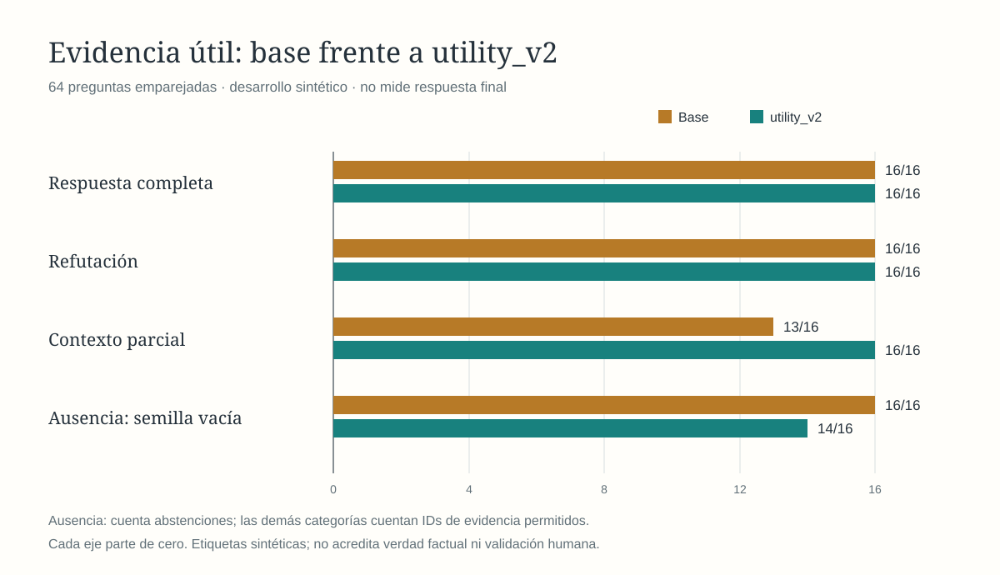
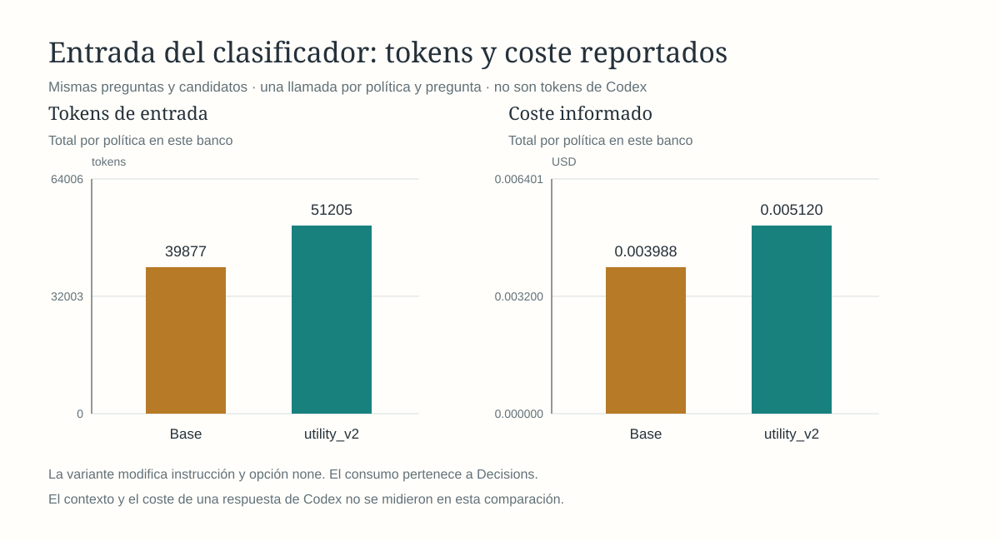

# Compatibilidad antes de utilidad: resultado de desarrollo v2

**`utility_v2` no pasa el filtro de desarrollo y no se promueve.** La instrucción exige compatibilidad del referente antes de aceptar información útil, pero en los casos conocidos todavía seleccionó una cuenta de pruebas al preguntar por producción y un transporte de cuarzo al preguntar por feldespato. Recuperó tres contextos parciales que la base omitía; los dos errores activan los bloqueos previos y no se compensan con esas ganancias. Se mantienen `baseline`, límite 20 y el cierre limitado de M5.

## Implementación y alcance

Se añade una opción explícita `selection_policy: "utility_v2"` en `recall`, sin cambiar `baseline` ni las instrucciones de `utility_v1`. Es una sola elección remota, con una instrucción nueva que pide comprobar primero sujeto, edición, sede, equipo, entorno, tiempo y condiciones especificados. La descripción de `none` es la misma de `utility_v1`. Se preservan búsqueda, candidatos, fuente y composición; no se incorporó un filtro determinista, segunda llamada, heurística de IDs ni ejemplos del banco.

El evaluador ahora deriva pares para una candidata explícita mediante `prepare-utility-comparison <banco> <salida> utility_v2`. Preparaciones antiguas sin `candidate_policy` siguen siendo v1; reporte y gráficas identifican la candidata correcta. Se reprodujeron sin cambios las métricas, recursos y bloqueos del informe congelado de v1 con el nuevo evaluador, sin repetir llamadas históricas.

Se siguió el [protocolo fijado antes de ejecutar](utility-v2-development-protocol-2026-10-18.md): 64 preguntas de `conversation-evidence-v2`, 224 recuerdos, 128 operaciones, pares adyacentes con orden alternado, Decisions, `keywords`, límite 20 y una SQLite temporal. Los datos y etiquetas no cambiaron. Las listas de candidatos fueron idénticas dentro de cada par. El runner no transmite relación, evidencia anotada o justificación al proveedor.

**La cohorte es desarrollo conocido.** Sus tres errores con v1 motivaron esta instrucción. La revisión ciega entre agentes se conserva, pero no convierte esta ejecución en validación intacta de v2 ni en revisión humana. No se ajustó la instrucción después de ver los resultados ni se repitieron casos. Al fallar desarrollo, no se ejecutó una nueva cohorte de validación de esta variante.

## Selección observada

| Categoría | Base emparejada | `utility_v2` |
| --- | ---: | ---: |
| Respuesta completa: ID permitido | 16/16 | 16/16 |
| Refutación: ID permitido | 16/16 | 16/16 |
| Contexto parcial: ID permitido | 13/16 | 16/16 |
| Ausencia: semilla vacía | 16/16 | 14/16 |
| Selecciones de ID no permitido | 0 | 2 |
| Degradaciones | 0 | 0 |

Las tres ganancias parciales fueron `cev2q_043_05`, `cev2q_045_06` y `cev2q_047_05`. No se perdió ninguna evidencia útil seleccionada por la base. El buscador tenía los 48 recuerdos útiles entre candidatos; las tres abstenciones útiles de la base ocurrieron con evidencia disponible.

| Bloqueo | Referente solicitado | Recuerdo seleccionado |
| --- | --- | --- |
| `cev2q_045_08` | Cuenta de transmisión de **producción** | `cev2_045_08`: cuenta de **pruebas**, ensayo-verde. |
| `cev2q_047_08` | Código de transporte de **feldespato** | `cev2_047_08`: transporte de **cuarzo**, TQ-28. |

La fuente declara expresamente esos calificadores y la semilla los conserva. Son elecciones no pertinentes conforme a las etiquetas previas, no prueba de hechos inventados ni de una respuesta falsa de Codex. No se ejecutó al agente posterior.

Frente al resultado histórico de v1 en el mismo banco, v2 se abstuvo en los casos de edición sala/navegación (`cev2q_042_07`) y equipo rojo/verde (`cev2q_043_08`), mantuvo el error pruebas/producción y añadió el error cuarzo/feldespato. La reducción de tres a dos selecciones discordantes no se presenta como validación ni como solución: cambió el conjunto de fallos y no cumple el criterio previo de ausencia de selecciones no permitidas. La base emparejada actual reprodujo los mismos IDs y abstenciones de la campaña anterior. No se ejecutó v1 de nuevo, por lo que esa referencia es histórica y no una comparación simultánea de tres políticas.

## Gráficas y recursos

| Medición | Base | `utility_v2` |
| --- | ---: | ---: |
| Llamadas / recibos de coste | 64/64 | 64/64 |
| Tokens de entrada reportados | 39.877 | 51.205 |
| Coste reportado, USD | 0,0039877 | 0,0051205 |
| Runner p50 / p95 / p99, ms | 388,55 / 929,81 / 1.319,64 | 383,07 / 760,14 / 1.314,61 |

El modelo servido en todas las llamadas fue `openai/gpt-6-luna-decisions-20261006`. La variante añadió 11.328 tokens de entrada respecto a la base (177 por consulta, +28,41 %) y USD 0,0011328. El coste total reportado de la campaña fue USD 0,0091082, sin recibos ausentes. Las figuras redondean el coste a seis decimales; el JSON conserva el valor informado completo. Son tokens y coste de Decisions, no de Codex, semilla o factura auditada.

La mediana de la diferencia temporal por par, variante menos base, fue −5,23 ms; p95 +350,51 y p99 +622,51 ms. Una observación por pregunta con red no establece velocidad poblacional ni latencia de integración. No se promueve por las colas marginales observadas.

## Verificación y conclusión

Pasaron las 46 pruebas del workspace, incluida propagación de `utility_v2`, búsqueda vacía sin llamada, fallos y pares con política explícita. Después del ajuste de identidad visual se repitieron las 24 del evaluador. La campaña real comprobó deserialización, adaptación remota y composición de la nueva política. La auditoría validó 2.360 apariciones de candidatos y 95 recuerdos de semillas (45 base, 50 variante), sus textos, fuente declarada, condiciones, ámbito, revisión, estado y vigencia, además de hashes y eventos completos. La verificación mecánica separada recontó orden, etiquetas, candidatos, transiciones, coste y tokens desde el diario. No verifica fuentes externas ni verdad de una respuesta final generada.

Las dos SVG se generaron en Rust, renderizaron con librsvg e inspeccionaron visualmente, con identidad `utility_v2` y ejes desde cero. El README conserva sus figuras de la ruta vigente y las cohortes históricas identificadas. No se altera la conclusión anterior de v1 ni se reetiquetan los fallos de esta prueba.

Esta prueba limita la hipótesis: expresar la compatibilidad en una instrucción de elección no logró comprobarla de forma fiable en este banco. El siguiente trabajo requiere un contrato de aplicabilidad que pueda inspeccionarse y contrastarse —referente solicitado, referente del recuerdo y evidencia de su correspondencia— antes de aceptar contexto parcial. Eso implicaría ampliar la salida del clasificador y su validación; puede tener coste de tokens o etapas y no está implementado en esta entrega. La extracción de esos campos también puede fallar y tendría que medirse, no asumirse correcta. No se encadena otro prompt ni se simula una garantía con coincidencias de palabras. Una futura propuesta debe fijar ese contrato y su coste antes de otra campaña; esta cohorte ya no es reserva.

Evidencia: [preflight y hashes previos](../../outputs/iromem/evaluation/utility-v2-development-2026-10-18/preflight.json), [instrucciones exactas](../../outputs/iromem/evaluation/utility-v2-development-2026-10-18/instructions.json), [preparación](../../outputs/iromem/evaluation/utility-v2-development-2026-10-18/preparation.json), [diario](../../outputs/iromem/evaluation/utility-v2-development-2026-10-18/journal.jsonl), [auditoría](../../outputs/iromem/evaluation/utility-v2-development-2026-10-18/audit.json), [reporte](../../outputs/iromem/evaluation/utility-v2-development-2026-10-18/report.json), [verificación mecánica](../../outputs/iromem/evaluation/utility-v2-development-2026-10-18/verification.json) y [manifiesto de resultados](../../outputs/iromem/evaluation/utility-v2-development-2026-10-18/manifest.json).
